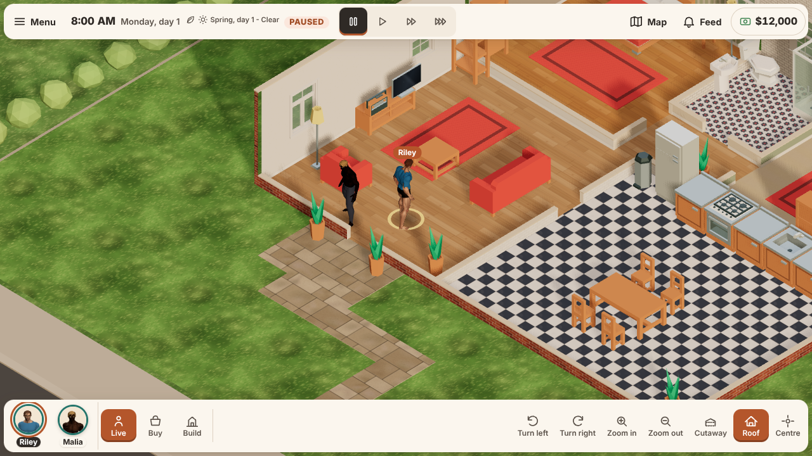
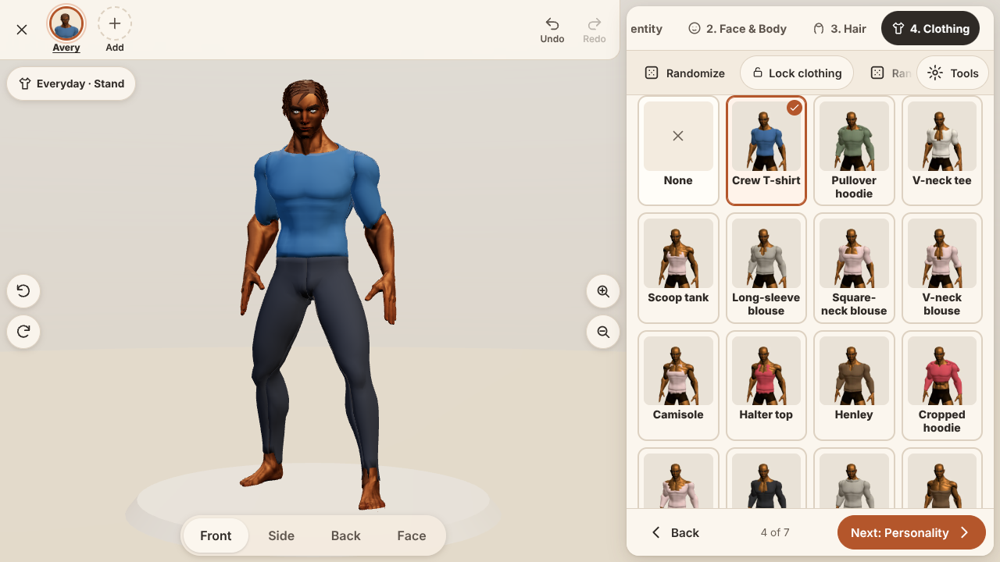
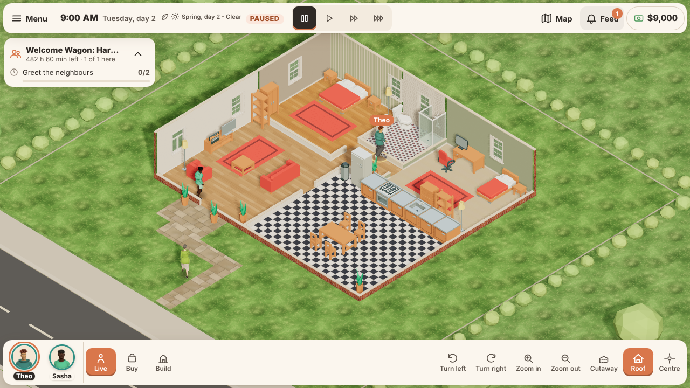

<p align="center">
  
</p>

<h1 align="center">Hearthside Life</h1>

<p align="center">
  <strong>A cozy life simulation that you build from the ground up.</strong><br>
  Create a household, design a home and follow everyday life – one choice at a time.
</p>

<p align="center">
  <a href="https://github.com/felixarvid2/Hearthside_life/releases/latest"></a>
  
  
</p>

Hearthside Life is an original single-player life simulation for the browser. There is no pre-made neighbourhood to move into: you create the people, build the house and decide what kind of life they should have.

The first public build, **v0.1.0**, is available for Android and Linux. It is still in active development, but the core loop is playable from character creation to everyday life at home.

## Play

Download **Hearthside Life 0.1.0** from [Releases](https://github.com/felixarvid2/Hearthside_life/releases/latest):

- **Android** – install `hearthside-life-0.1.0.apk` (allow installs from unknown sources).
- **Linux** – install `hearthside-life_0.1.0_amd64.deb`.
- **Browser** – run the development build with the commands under *Development*.

## Create a life

The character creator walks through face, body and hair, clothing and patterns, personality, household ties, and presets. You can lock the parts you like, randomise the rest, and undo or redo as you go.

Then move in and play:

- **Live mode** – six needs, an action queue, autonomy, cooking, sleeping, socialising and relationships.
- **Build and buy** – walls, floors, doors, windows and furniture, with palettes and full undo/redo.
- **Careers and skills** – work shifts, earn money and improve skills and aspirations.
- **Events and visitors** – dates, dinners, house parties, celebrations and neighbours who stay, eat and leave politely.
- **Saves** – five named slots, autosave, a last-known-good backup, and export/import as JSON.
- **Accessibility** – keyboard-only play, UI scaling, high contrast, reduced motion and touch targets that work on small screens.

| Creator | A home in spring |
|---|---|
|  |  |

## Controls

### Touch

- Tap a person to select them, or an object to open its menu.
- Tap the floor to walk there.
- Drag to pan, pinch to zoom, and use the camera buttons to turn the view.

### Desktop and keyboard

| Input | Action |
|---|---|
| Click | Select and use |
| Drag / right-drag | Pan |
| Mouse wheel | Zoom |
| `W` `A` `S` `D` or arrows | Pan |
| `Q` / `E` | Turn the camera |
| `+` / `-` | Zoom |
| `Space` | Pause or resume |
| `1` `2` `3` | Game speed |
| `R` | Rotate the object being placed |
| `Delete` / `Backspace` | Sell |
| `Ctrl+Z` / `Ctrl+Y` | Undo / redo |
| `Esc` | Cancel or close |

Everything outside the 3D world is reachable with `Tab`, `Shift+Tab`, `Enter` and `Space`. Help, hints and settings are available from the main menu and the in-game menu.

## Development

<details>
<summary>Run and build from source</summary>

Requires Node.js and npm.

```bash
npm install
npm run dev       # development server
npm run build     # type check and production build
npm run preview   # serve the production build
npm test          # unit tests
```

The game is built with Three.js, TypeScript and Vite. The design goals are in [docs/DESIGN_BRIEF.md](docs/DESIGN_BRIEF.md), the roadmap in [docs/ROADMAP.md](docs/ROADMAP.md) and the current state in [docs/CONTINUATION.md](docs/CONTINUATION.md). Packaging notes for Linux and Android are in the same repository.

</details>

## Credits

Hearthside Life is an original project. Character animations and classic bodies use Quaternius' Universal Animation Library (CC0); furniture and UI sounds use Kenney's CC0 assets; some surfaces and character bodies were generated with Meshy and fal.ai. All other characters, furniture, faces, hair and clothing are generated by the project's own code.

See [public/assets/LICENSES.md](public/assets/LICENSES.md) for the full list.
